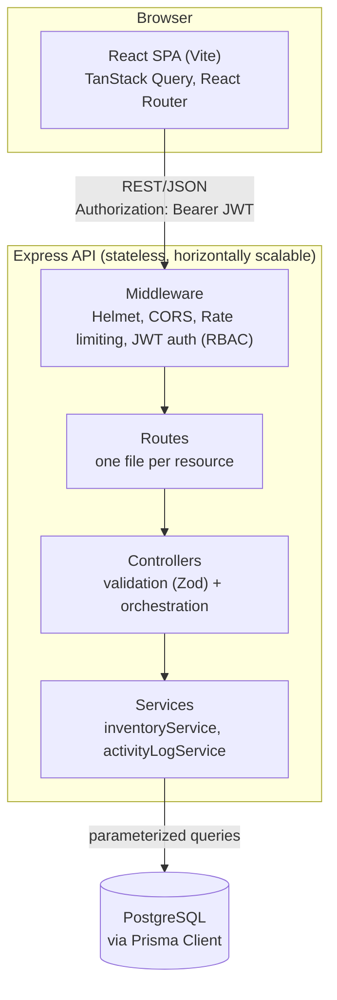
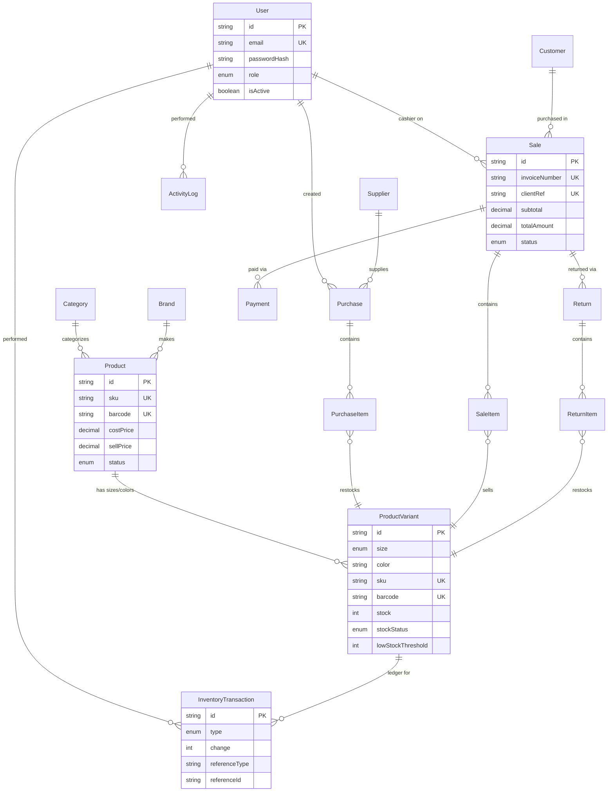
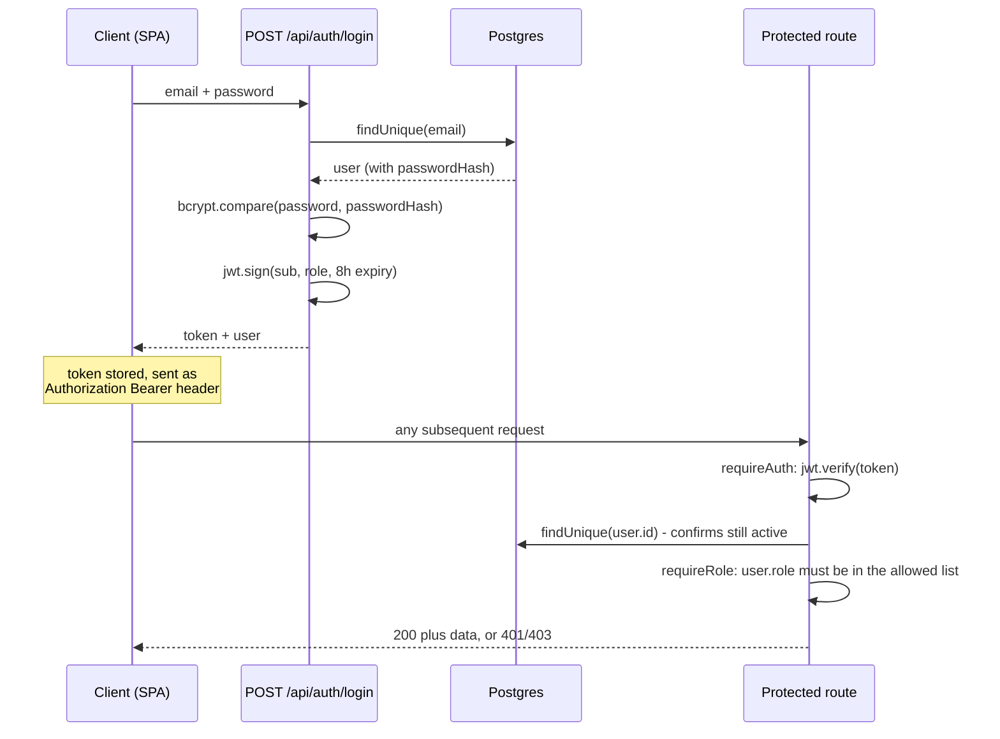
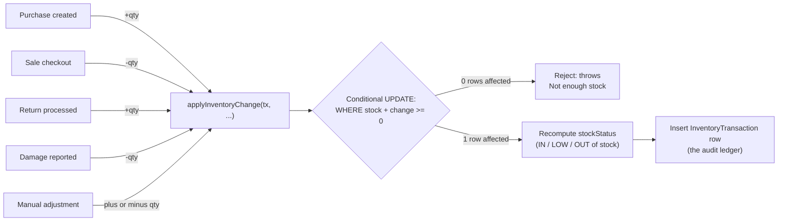
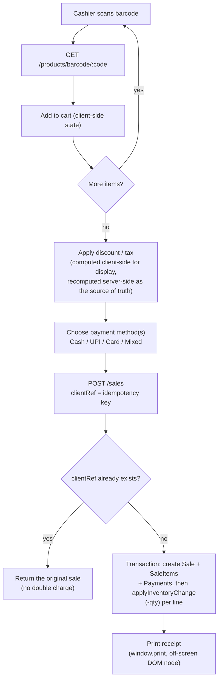

# ThreadLine — POS & Store Management for Clothing Retailers

ThreadLine is a full-stack point-of-sale and store management system built
for a physical clothing store — billing, inventory, purchases, returns,
reporting, and staff management. It is not an e-commerce storefront; there
is no customer-facing site. Everything here is built for the people behind
the counter: cashiers, managers, and owners.

**Live status:** Version 1.0 release candidate. See [`FINAL_REVIEW.md`](./FINAL_REVIEW.md)
for the honest, itemized go/no-go assessment, and
[`PRODUCTION_REVIEW.md`](./PRODUCTION_REVIEW.md) / [`CODE_REVIEW.md`](./CODE_REVIEW.md)
/ [`POLISH_NOTES.md`](./POLISH_NOTES.md) for the full history of what was
found and fixed across each development pass.

---

## Table of contents

- [Screenshots](#screenshots)
- [Demo credentials](#demo-credentials)
- [Tech stack](#tech-stack)
- [Architecture](#architecture)
- [Database schema (ER diagram)](#database-schema-er-diagram)
- [Core flows](#core-flows)
  - [Authentication & authorization](#authentication--authorization)
  - [Inventory ledger](#inventory-ledger)
  - [POS checkout](#pos-checkout)
- [Folder structure](#folder-structure)
- [API overview](#api-overview)
- [Setup guide](#setup-guide)
- [Populating demo data](#populating-demo-data)
- [Deployment guide](#deployment-guide)
- [Known limitations](#known-limitations)
- [Future improvements](#future-improvements)

---

## Screenshots

This is a self-hosted app with no public demo URL, so screenshots aren't
bundled as static images in this repo — they'd go stale the moment the UI
changes. To generate an up-to-date set: run the app locally (see
[Setup guide](#setup-guide)), seed the [demo data](#populating-demo-data),
log in, and capture:

1. Dashboard (`/`) — stat cards, sales chart, category performance
2. POS (`/pos`) — an in-progress sale with a few cart items
3. Inventory (`/inventory`) — the Stock tab with a low-stock filter applied
4. Products (`/products`) — the product list and the "Add product" drawer
5. Reports (`/reports`)

If you're packaging this for a portfolio site, drop the images in
`docs/screenshots/` and reference them here.

## Demo credentials

After running the [seed scripts](#populating-demo-data):

| Role | Email | Password |
|---|---|---|
| Owner | `owner@store.com` | `password123` |
| Manager | `manager@store.com` | `password123` |
| Cashier | `cashier@store.com` | `password123` |
| Cashier | `cashier2@store.com` | `password123` |

Role permissions, concretely:
- **Cashier** — POS, Inventory (view), Customers, Suppliers, Returns
- **Manager** — everything Cashier can do, plus Products, Purchases,
  Reports, Categories & Brands, Activity Logs, Store Settings
- **Owner** — everything Manager can do, plus creating new staff accounts
  (`POST /api/auth/users`)

---

## Tech stack

**Backend:** Node.js, Express, PostgreSQL, Prisma ORM, JWT auth, Zod
validation, Vitest
**Frontend:** React, TypeScript, Vite, Tailwind CSS, TanStack Query,
Recharts, Radix UI primitives, React Router, JsBarcode, PapaParse, ESLint

---

## Architecture

A conventional three-tier architecture: a React SPA talks to a stateless
Express API over JSON, which is the only thing that ever touches Postgres.



**Why this split:** controllers stay thin (parse/validate the request,
call a service, shape the response); anything that's a genuine business
rule — most importantly, "how does stock ever change" — lives in
`services/`, one level down, so it can be reused (the POS checkout, a
purchase, a return, and a manual adjustment all call the *same* function)
and unit-tested in isolation (see `backend/src/services/__tests__/`).

---

## Database schema (ER diagram)



A few things worth calling out about the schema itself:

- **`ProductVariant.stockStatus` is denormalized on purpose.** It's
  recomputed and persisted in the same write as `stock` (see
  `inventoryService.applyInventoryChange`), which is what lets low-stock /
  out-of-stock filtering be a simple indexed `WHERE` clause instead of a
  runtime computation over every row.
- **`Sale.clientRef` is a checkout idempotency key.** A repeated request
  with the same client-generated key returns the original sale instead of
  double-charging.
- **Foreign keys are all explicitly indexed** (`@@index` on every
  relation scalar column) — Postgres, unlike MySQL, does not create these
  automatically just because a `@relation` exists.
- **`PurchaseItem`/`SaleItem`/`ReturnItem` -> `ProductVariant` intentionally
  have no cascading delete.** A variant that's ever been part of a
  purchase, sale, or return can never be hard-deleted out from under its
  own history (Postgres's default `RESTRICT` refuses the delete instead).

---

## Core flows

### Authentication & authorization



Rate limiting sits in front of `/api/auth/*` specifically (10 requests/
minute/IP) as the actual brute-force defense — login has no other
throttling.

### Inventory ledger

This is the one invariant the whole system is built around: **stock is
never written directly.** Every code path that changes `stock` — a
purchase, a sale, a return, a damage report, a manual correction — goes
through exactly one function.



The conditional `UPDATE ... WHERE stock + change >= 0` (implemented as a
Prisma `updateMany` with a `gte` guard) is what makes this safe under
concurrency: two simultaneous sales for the last unit of a variant cannot
both succeed, because the *write itself* re-checks the current row instead
of trusting a value read a moment earlier. This exact scenario — two sales
racing for the last unit — is covered by an automated test in
`backend/src/services/__tests__/inventoryService.test.js`.

### POS checkout



---

## Folder structure

```
clothing-store-pos/
├── backend/
│   ├── prisma/
│   │   ├── schema.prisma       # full data model
│   │   ├── seed.js             # 4 login accounts + 1 sample product (fast)
│   │   └── seedDemo.js         # realistic bulk demo dataset (see below)
│   ├── src/
│   │   ├── config/             # Prisma client singleton, env validation
│   │   ├── middlewares/        # JWT auth + RBAC, centralized error handler
│   │   ├── controllers/        # one per resource - validation + orchestration
│   │   ├── routes/             # one per resource
│   │   ├── services/
│   │   │   ├── inventoryService.js    # the stock ledger - see Core Flows above
│   │   │   ├── activityLogService.js
│   │   │   └── __tests__/             # Vitest suite
│   │   ├── utils/               # ApiError, pagination helpers
│   │   ├── app.js               # Express app assembly (middleware + routes)
│   │   └── server.js            # boot: env validation, then listen
│   └── vitest.config.js
└── frontend/
    └── src/
        ├── components/
        │   ├── ui/               # Button, Card, Input, Select, Drawer, Pagination, ...
        │   ├── layout/           # Sidebar, Navbar, PageHeader
        │   ├── pos/              # Receipt, CustomerPicker, HeldBillsDrawer
        │   ├── products/         # ProductFormDrawer, VariantRows
        │   └── inventory/        # BarcodeLabel, BulkImportDrawer, InventoryTimeline
        ├── contexts/             # AuthContext, ToastContext
        ├── hooks/                # useDebouncedValue
        ├── layouts/              # DashboardLayout (sidebar + navbar shell)
        ├── pages/                # one per screen
        ├── routes/               # AppRouter (lazy-loaded routes), ProtectedRoute
        ├── services/api.ts       # axios client, JWT injection, 401 handling
        └── types/                # shared TS types mirroring the Prisma schema
```

---

## API overview

All routes are under `/api`, JSON in and out, `Authorization: Bearer <jwt>`
required except `/api/auth/login` and `/api/health`.

| Resource | Routes | Notes |
|---|---|---|
| Auth | `POST /auth/login`, `GET /auth/me`, `GET/POST /auth/users` | user management is Owner/Manager only |
| Products | `GET/POST /products`, `GET/PATCH/DELETE /products/:id`, `GET /products/barcode/:code`, `POST /products/bulk-import` | barcode lookup powers the POS scanner |
| Categories / Brands | `GET/POST/PATCH/DELETE /categories`, same for `/brands` | soft-delete (deactivate) only |
| Suppliers | `GET/POST/PATCH/DELETE /suppliers` | |
| Customers | `GET/POST/PATCH /customers`, `GET /customers/:id` | `:id` includes full purchase history |
| Purchases | `GET/POST /purchases`, `GET /purchases/:id` | Owner/Manager only; increases stock |
| Sales (POS) | `GET/POST /sales`, `GET /sales/:id` | all roles; decreases stock; supports `clientRef` idempotency |
| Returns | `GET/POST /returns` | validates against original sale quantity, never over-refunds |
| Inventory | `GET /inventory`, `GET /inventory/summary`, `GET /inventory/history`, `POST /inventory/adjust` | `/adjust` is the only manual stock-correction path, still ledgered |
| Dashboard | `GET /dashboard/summary`, `/sales-chart`, `/category-performance`, `/recent-activity` | |
| Settings | `GET/PATCH /settings` | single-row store profile |
| Activity Logs | `GET /activity-logs` | Owner/Manager only, paginated |

Every list endpoint accepts `page`/`pageSize` and returns
`{ data, meta: { page, pageSize, total, totalPages } }`.

---

## Setup guide

### Prerequisites

- Node.js 18+
- PostgreSQL 14+ (or Docker)

### 1. Database

```bash
docker run --name threadline-pg -e POSTGRES_PASSWORD=postgres -e POSTGRES_DB=clothing_store -p 5432:5432 -d postgres:16
```

### 2. Backend

```bash
cd backend
npm install
cp .env.example .env       # set DATABASE_URL and a real JWT_SECRET (16+ chars)
npx prisma migrate dev --name init
npm run seed                # 4 accounts + 1 sample product
npm run dev                 # http://localhost:4000
npm test                    # optional: run the inventory-service test suite
```

The server validates `DATABASE_URL`/`JWT_SECRET` at boot and refuses to
start with a clear error message if either is missing or too short —
you'll know immediately if `.env` isn't configured correctly.

### 3. Frontend

```bash
cd frontend
npm install
cp .env.example .env        # VITE_API_URL, defaults to http://localhost:4000/api
npm run dev                  # http://localhost:5173
npm run lint                 # ESLint
```

Log in with any of the [demo credentials](#demo-credentials) above.

---

## Populating demo data

For a portfolio/client-demo instance, run the bulk demo data generator
after the steps above:

```bash
cd backend
npm run seed:demo
```

This generates a realistic, browsable dataset: 20 categories, 15 brands,
50 suppliers, 150 customers, 200+ products (each with 2-4 size/colour
variants), 250 purchases, 600 sales (dated with a recency bias so the
dashboard's charts look like an actually-open store), ~40 returns, and a
matching inventory ledger + activity log. **This takes several minutes** —
it's generating and writing several thousand records with real relational
integrity, not a bulk CSV load. Progress is logged to the console.

See the comment block at the top of `backend/prisma/seedDemo.js` for a
detailed explanation of one deliberate design choice: that script tracks
stock in an in-memory map and writes the inventory ledger in bulk at the
end, rather than calling `applyInventoryChange` per line item like the
real app does — calling the real (correctly-conservative, multi-round-trip)
function ~15,000 times would make seeding take the better part of an hour.
The math is identical either way; only the runtime app is held to
"never touch `stock` except through that one function."

---

## Deployment guide

This is a standard two-process deployment (API + static frontend) plus a
managed Postgres instance. There's no bundled Dockerfile/CI config in this
repo — this section describes the shape of a deployment, not a
one-command script.

### Database
Any managed Postgres works (Supabase, Railway, RDS, Neon, etc.). Run
`npx prisma migrate deploy` (not `migrate dev`) against the production
`DATABASE_URL` as part of your release step.

### Backend
- Deploy `backend/` to any Node host (Railway, Render, Fly.io, a plain VM).
- Required env vars: `DATABASE_URL`, `JWT_SECRET` (long random string),
  `CLIENT_ORIGIN` (your deployed frontend's exact origin — **required**,
  the server will not boot without it when `NODE_ENV=production`, because
  CORS with credentials cannot use a wildcard origin), `PORT`.
- Run `npx prisma migrate deploy` then `node src/server.js` (or via
  `npm start`).

### Frontend
- `npm run build` produces a static `dist/` — deploy it to any static host
  (Vercel, Netlify, Cloudflare Pages) or serve it behind the same reverse
  proxy as the API.
- Set `VITE_API_URL` at build time to the deployed backend's URL.

### Things to double check before a real deployment
- Rotate `JWT_SECRET` and the demo account passwords — everything above
  uses `password123` for local/demo convenience only.
- Put both services behind HTTPS (the JWT is a bearer token; HTTPS is not
  optional in any real deployment).
- Review `backend/.env.example` for the full list of variables.

---

## Known limitations

Documented explicitly rather than discovered by a client — see
[`FINAL_REVIEW.md`](./FINAL_REVIEW.md) for the full, ranked list with
severities. The short version:

- **No automated browser/E2E tests** — the backend has a focused Vitest
  suite for the highest-risk logic (the inventory ledger), but there is no
  Playwright/Cypress coverage of the frontend flows. QA on the frontend
  has been thorough manual/code-level tracing across multiple review
  passes, not automated regression coverage.
- **Money is `Decimal` in Postgres but floating-point in application
  arithmetic** (rounded at each calculation boundary). Correct at this
  scale; a bank-grade rewrite would use integer minor-units throughout.
- **No dedicated variant-editing UI.** The backend supports editing an
  existing variant's price/threshold/size/color via `PATCH /products/:id`;
  the "Add product" drawer doesn't yet have an "Edit" counterpart.
- **Reports export as CSV, not native PDF/XLSX.** CSV opens correctly in
  Excel/Sheets; a formatted PDF layout is a follow-up.
- **No shared `DataTable` component.** Products/Inventory/Customers/
  Suppliers/Purchases each implement their own table + search + pagination
  wiring. Functionally consistent, but more code than a shared abstraction
  would need.
- **Single-store only.** The schema and every query assume one store; there
  is no store-scoping anywhere. This is a scope boundary, not a bug.

## Future improvements

Roughly in the order they'd add the most value:

1. Playwright E2E coverage for the POS checkout and returns flows —
   the highest-value automated-testing gap given how central they are.
2. A shared `DataTable` (sortable columns, consistent pagination/search)
   to replace the current per-page hand-rolled tables.
3. Native PDF export for reports and receipts.
4. Product image upload (the schema already has an `images` field; needs
   object storage, e.g. S3-compatible).
5. Integer-based money storage, if this ever needs to be bank-grade rather
   than "correct at small-business retail scale."
6. Structured logging (pino) in place of `console.log`/`console.error`.
